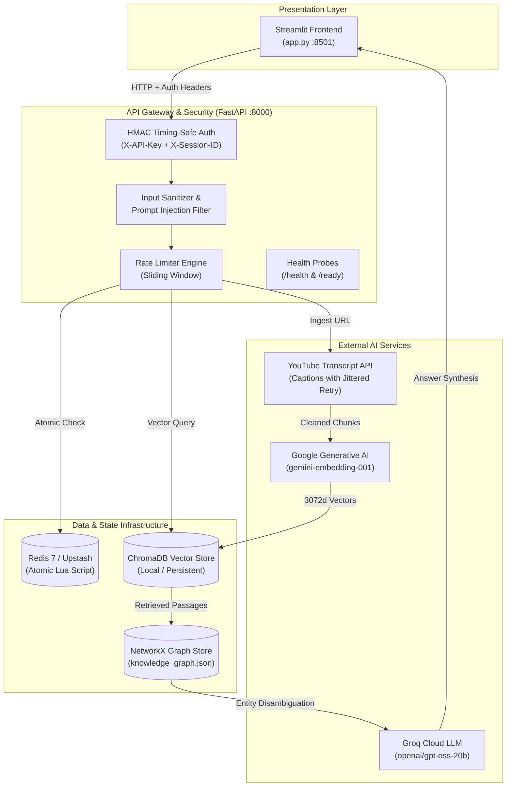
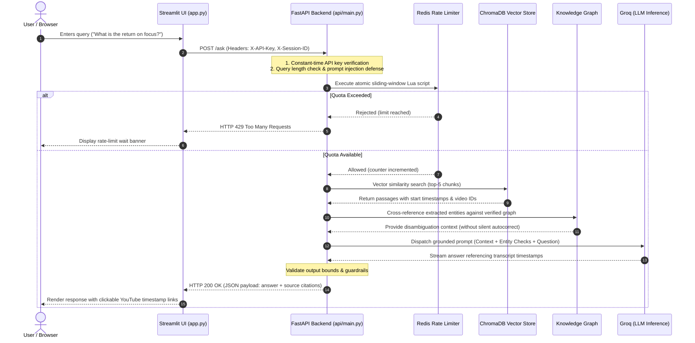

# 🎥 YouTube RAG Assistant

A production-grade, containerized YouTube transcript Retrieval-Augmented Generation (RAG) system featuring timestamped citations, Redis-backed sliding-window rate limiting, entity knowledge graph cross-referencing, an authenticated FastAPI backend, and an interactive Streamlit frontend.

---

## Architecture Overview



---

## End-to-End Request Lifecycle

The diagram below traces a user query from the moment it is entered in the browser to the final timestamped response:



---

## Key Highlights

- **Timestamped Direct Citations**: Every generated fact links directly to the exact second in the source video (`?t=515s`), enabling instant human verification.
- **Timing-Safe Service Authentication**: All operational endpoints enforce constant-time `hmac.compare_digest` validation on the `X-API-Key` header.
- **Session-Aware Rate Limiting**: The client automatically tags requests with an isolated session identifier (`X-Session-ID`), enforcing per-user quotas (10 requests/min) alongside global infrastructure protection (100 requests/min).
- **Hardened Prompt Security**: Token-level patterns and regex heuristics reject prompt injection vectors (`[INST]`, `<system>`, `DAN mode`, `jailbreak`) before hitting the LLM.
- **Atomic Sliding Window with Fail-Safe**: Redis rate limiting runs inside an atomic Lua script. If Redis disconnects, the API responds with a structured HTTP 503 instead of crashing with an unhandled 500 error.
- **Redis Transcript Cache**: Timestamped transcript segments are cached across API instances to avoid repeated YouTube requests.
- **Redis Answer Caching**: Exact per-session answers are cached with their source chunks; high-threshold semantic matching can reuse near-identical queries. Cache entries are invalidated when the indexed corpus changes.
- **Entity Knowledge Graph**: NetworkX graph store paired with RapidFuzz string scoring. Resolves spoken transcript variations against reviewed canonical entities while preserving provenance.
- **Production Containerization**: Multi-stage, non-root `Dockerfile` and a 3-service `docker-compose.yml` for turnkey reproducibility.
- **Zero-Cost Hosting Architecture**: Engineered to operate cleanly inside free-tier allowances ($0 / month).

---

## Technical Stack

| Layer | Technology | Role |
|---|---|---|
| **Frontend** | Streamlit 1.66+ | Session-managed web interface |
| **Backend API** | FastAPI + Uvicorn | Asynchronous REST gateway |
| **Embeddings** | Google Generative AI | `gemini-embedding-001` (3072 dimensions) |
| **Vector Store** | ChromaDB 1.5+ | Local persistent vector index |
| **Language Model** | Groq Cloud | `openai/gpt-oss-20b` (low-latency grounded generation) |
| **Rate Limiter** | Redis 7 + Lua | Distributed atomic sliding-window engine |
| **Graph Store** | NetworkX + RapidFuzz | Entity cross-referencing and alias matching |
| **Test Double** | FakeRedis [Lua] | Offline unit and integration test execution |

---

## System Components

```text
├── api/
│   ├── main.py                   # FastAPI REST service and route handlers
│   └── __init__.py
├── config.py                     # Centralized settings and environment validation
├── exceptions.py                 # Domain exception hierarchy
├── logging_config.py             # Formatted application logger
├── rag.py                        # RAG pipeline, prompt assembly, and inference
├── app.py                        # Streamlit interactive UI
├── ingestion/
│   ├── ingestion.py              # Chunking, metadata preservation, and Chroma indexing
│   └── yt_client.py              # YouTube transcript extraction with retry backoff
├── knowledge_graph/
│   ├── graph_store.py            # NetworkX graph persistence and alias fuzzy matching
│   └── entity_verification.py    # Verification heuristics and review pipelines
├── infrastructure/
│   └── rate_limiter.py           # Atomic Redis Lua sliding window with health check
├── security/
│   ├── guardrails.py             # Response length and format validators
│   ├── input_validation.py       # Query length and input sanitizer
│   └── prompt_security.py        # Prompt injection pattern rejection
├── tests/                        # 65 automated test suites
├── Dockerfile                    # Multi-stage production container
├── docker-compose.yml            # Multi-service local environment (API + Redis + Frontend)
├── render.yaml                   # Free-tier deployment blueprint
├── requirements.txt              # Standard production dependencies
└── .env.example                  # Environment variable template
```

---

## Quickstart

### Running with Docker Compose

The easiest way to start the entire authenticated stack locally:

```bash
# 1. Clone the repository
git clone https://github.com/Lemniscate-2525/YT_ChatBot.git
cd YT_ChatBot

# 2. Configure keys
cp .env.example .env
# Edit .env and insert your GEMINI_API_KEY and GROQ_API_KEY

# 3. Spin up all services
docker compose up --build
```

Endpoints available immediately:
- **Streamlit Web App**: http://localhost:8501
- **API Liveness Probe**: http://localhost:8000/health
- **API Readiness Probe**: http://localhost:8000/ready

---

### Running Natively

If you prefer running without Docker:

```powershell
# 1. Prepare virtual environment
python -m venv .venv
.venv\Scripts\Activate.ps1
python -m pip install --upgrade pip
pip install -r requirements.txt

# 2. Environment configuration
cp .env.example .env

# 3. Launch FastAPI backend (Terminal 1)
uvicorn api.main:app --reload --port 8000

# 4. Launch Streamlit UI (Terminal 2)
streamlit run app.py
```

---

## Configuration Reference

All application parameters are consolidated and validated in `config.py`:

| Variable | Required | Default | Description |
|---|---|---|---|
| `GEMINI_API_KEY` | Yes | None | Google AI Studio key for `gemini-embedding-001` |
| `GROQ_API_KEY` | Yes | None | Groq API key for LLM generation |
| `RAG_API_KEY` | Yes | None | Secret shared between frontend and API gateway |
| `REDIS_URL` | No | `redis://localhost:6379/0` | Redis instance connection URI |
| `REDIS_TIMEOUT` | No | `2.0` | Socket connect and read timeout in seconds |
| `GLOBAL_LIMIT` | No | `100` | Max system requests per rate-limit window |
| `USER_LIMIT` | No | `10` | Max requests per session per rate-limit window |
| `RATE_LIMIT_WINDOW`| No | `60` | Duration of sliding window in seconds |
| `TRANSCRIPT_CACHE_TTL_SECONDS` | No | `2592000` | Redis transcript cache TTL |
| `ANSWER_CACHE_TTL_SECONDS` | No | `86400` | Exact per-user answer cache TTL |
| `SEMANTIC_CACHE_TTL_SECONDS` | No | `86400` | Semantic query cache TTL |
| `SEMANTIC_CACHE_THRESHOLD` | No | `0.985` | Minimum cosine similarity for semantic cache reuse |
| `SEMANTIC_CACHE_MAX_ENTRIES` | No | `200` | Maximum semantic candidates checked per user |
| `CHROMA_DIR` | No | `chroma_db` | Storage path for Chroma vector files |
| `KNOWLEDGE_GRAPH_PATH` | No | `data/knowledge_graph.json` | Path for persisted entity graph |
| `ENABLE_API_DOCS` | No | `false` | Enables `/docs` interactive Swagger UI |
| `CORS_ORIGINS` | No | `*` | Allowed CORS origins (comma-separated) |
| `RAG_API_URL` | No | `http://localhost:8000` | Target backend URL used by Streamlit |

---

## API Specification

All data endpoints require the `X-API-Key` header. Clients can optionally pass `X-Session-ID` to isolate user rate limits.

| Method | Route | Access | Function |
|---|---|---|---|
| `GET` | `/health` | Public | Liveness probe returning operational state |
| `GET` | `/ready` | Public | Readiness probe verifying storage and Redis health |
| `POST` | `/ingest` | Protected | Ingests, chunks, embeds, and indexes a YouTube video |
| `POST` | `/ask` | Protected | Performs validated retrieval and grounded RAG answer synthesis |
| `POST` | `/entities/register` | Protected | Registers human-reviewed canonical entities and aliases |
| `POST` | `/entities/resolve` | Protected | Matches input mentions against graph aliases using fuzzy scoring |
| `GET` | `/graph/summary` | Protected | Returns entity, video, and relationship node counts |

---

## Hybrid Local Transcript Worker

YouTube may block transcript requests from cloud-provider IP ranges. The hybrid mode keeps the deployed Streamlit + FastAPI + Redis + RAG stack, while a trusted worker on your own Windows machine retrieves captions with your local YouTube cookies.

**Flow:** Streamlit → FastAPI `POST /ingest/jobs` → Redis Streams → local yt-dlp worker → authenticated `POST /worker/transcripts` → existing chunking/embedding/Chroma ingestion. The browser cookies file never leaves the local worker.

### Setup

1. Deploy the API and configure `REDIS_URL` and a strong `TRANSCRIPT_WORKER_TOKEN` in Render. Set the same `REDIS_URL` (your hosted Redis connection string) and `TRANSCRIPT_WORKER_TOKEN` in your local `.env`.
2. Keep `youtube-cookies.txt` in the repository root on your own PC only. It is ignored by Git. Never upload it to GitHub, Streamlit, Render, or Redis.
3. Set `YOUTUBE_COOKIES_FILE=./youtube-cookies.txt` in local `.env`.
4. Install dependencies with `python -m pip install -r requirements.txt`. Ensure the local `.env` also has `RAG_API_URL` set to your deployed Render API URL.
5. Start the worker from the repository root with `python -m worker.transcript_worker`. Keep the machine awake and connected while new videos are being ingested.
6. Submit a video in Streamlit. The UI queues the job and polls its status. Existing indexed videos and RAG question answering continue to run in the cloud.

Jobs are retained for seven days, delivered through a Redis consumer group, retried up to three times, and abandoned pending deliveries are reclaimed after 60 seconds. If the local machine is offline, new jobs wait in Redis until the worker reconnects. Do not run the worker on a machine/profile that does not own or have permission to use the supplied YouTube session.

The legacy `POST /ingest` route remains available for local/dev use; the Streamlit UI uses the worker-backed queue route.

## Zero-Cost Cloud Deployment

This system is configured to run at zero monthly cost using free allowances across modern cloud services:

```text
Streamlit Community Cloud (Frontend)   -->   Render Web Service Free (API)   -->   Upstash Redis (Serverless)
       [100% Free Tier]                              [750 Free Hours/mo]                [10,000 Commands/day]
```

1. **Redis Layer (Upstash)**: Create a free serverless Redis database at upstash.com without credit card requirements. Copy the connection URL (`rediss://...`).
2. **Backend Gateway (Render)**: Deploy using the repository's `render.yaml` blueprint configured for `plan: free`. Provide `GEMINI_API_KEY`, `GROQ_API_KEY`, `REDIS_URL`, and `RAG_API_KEY` in environment settings.
3. **Frontend Application (Streamlit Cloud)**: Deploy `app.py` via share.streamlit.io. In App Settings -> Secrets, configure `RAG_API_URL` pointing to your Render service and the matching `RAG_API_KEY`.

---

## Test Suite & Verification

The codebase includes 65 automated tests verifying authentication contracts, schema validation, chunking determinism, offline vector storage, graph resolution, sliding-window rate limiting, and prompt security:

```bash
python -m pytest tests/ -v
```

All tests execute reliably in local offline environments (using embedded `fakeredis`) and in GitHub Actions CI (using a live Redis 7 service container and automated Docker build check).
